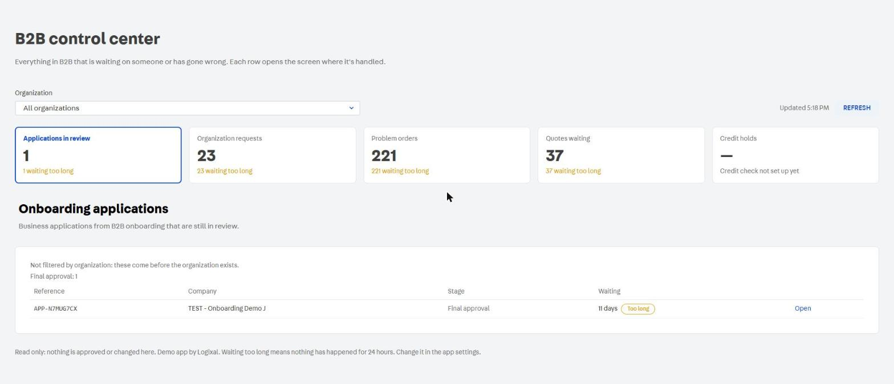
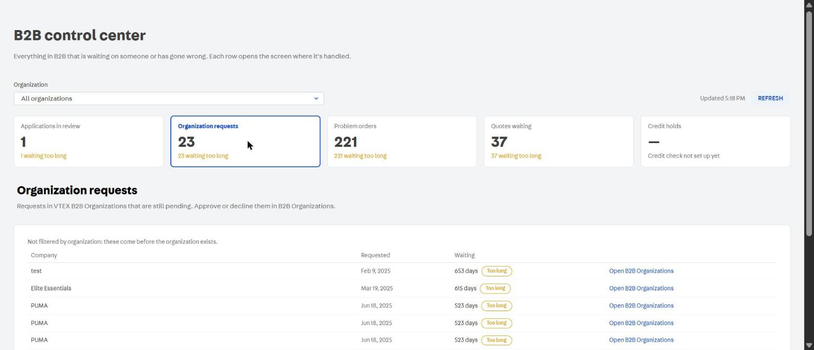
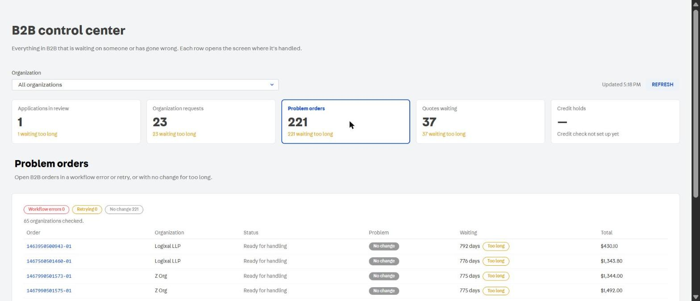
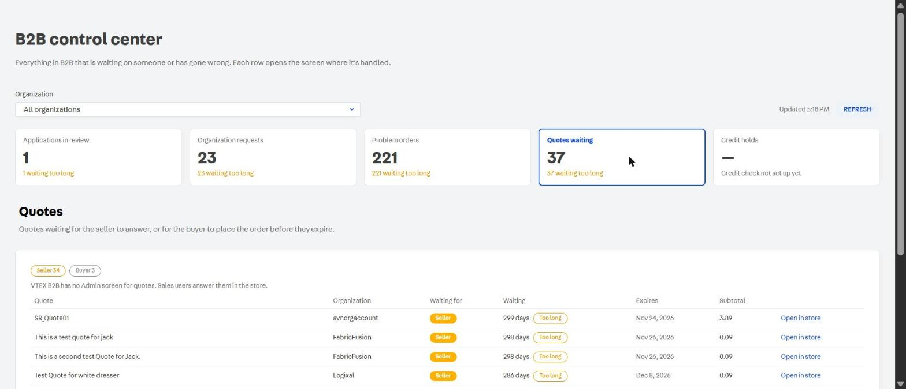
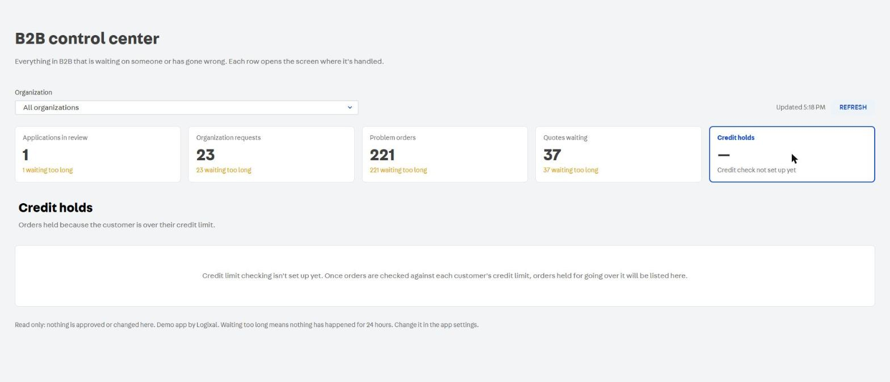

# B2B Control Center

One Admin screen for everything in B2B that is waiting on someone or has gone wrong. VTEX spreads that work across separate modules (Organizations, Organization Requests, Orders, Quotes). This app brings it together, counts what's waiting too long, and links every row to the screen where it's handled.



| | |
| --- | --- |
| App | `logixalpartnerus.b2b-control-center` |
| Version | 0.2.2 |
| Live in | Workspace `b2btest`, Admin → **Apps → Installed Apps → B2B control center** (`/admin/b2b-control-center`) |
| Type | Read-only Admin page. It never approves, retries or changes anything |
| Status | Internal Logixal demo app for prospective clients |

Full documentation: [user guide](docs/USER-GUIDE.md) and [technical reference](docs/TECHNICAL.md).

## Contents

1. [Why it exists](#why-it-exists)
2. [What it shows](#what-it-shows)
3. [Demo script](#demo-script)
4. [How it works](#how-it-works)
5. [Setup](#setup)
6. [Limitations and extension points](#limitations-and-extension-points)
7. [Development](#development)

## Why it exists

A B2B operations team has to check several VTEX screens to find what needs attention: new organization requests in B2B Organizations, stuck orders in Orders, quotes in the store, and, with our onboarding app, business applications in their own queue. Nothing tells them what has been waiting too long.

The control center answers one question on one page: **what is waiting on us, and for how long?**

## What it shows

Five count tiles sit at the top. Click a tile to see its list below. Each tile also counts the items **waiting too long**: nothing has happened to them for more than the configured number of hours (24 by default).

| Panel | Shows | Each row opens | Filtered by organization? |
| --- | --- | --- | --- |
| Applications in review | Business applications from [B2B Onboarding](https://github.com/debangi-choudhury/b2b-onboarding) still in review, by stage, oldest first | The application's review page | No: they come before the organization exists |
| Organization requests | VTEX's native organization requests still pending | B2B Organizations → Requests | No, for the same reason |
| Problem orders | B2B orders in a workflow error, retrying, or unchanged for too long | The order in Admin | Yes |
| Quotes waiting | Quotes waiting for the seller to answer, or for the buyer to order before they expire | The quote in the store (VTEX has no Admin screen for quotes) | Yes |
| Credit holds | Orders held for going over a customer's credit limit | — | Yes. Empty until credit limit checking exists |

### Organization requests



### Problem orders

The chips at the top split the list into workflow errors, retries and orders with no change.



### Quotes waiting

The chips show how many quotes wait on the seller and how many on the buyer.



### Credit holds

The panel is ready but empty, and explains why. It fills in once orders are checked against customers' credit limits.



## Demo script

About 5 minutes. Log in to the `b2btest` Admin first: https://b2btest--logixalpartnerus.myvtex.com/admin

1. **Open the page.** Go to **Apps → Installed Apps → B2B control center**. Explain the problem: B2B work is spread over several VTEX screens, and nothing shows what's overdue.
2. **Read the tiles.** Point out the counts and the orange "waiting too long" line under each.
3. **Applications in review.** Show the onboarding application waiting at Final approval. Click **Open**: it goes straight to that application's review page. Come back.
4. **Organization requests.** Show the pending requests from VTEX's own sign-up form, and the link to B2B Organizations, where they're approved.
5. **Problem orders.** Show the workflow error, retrying and no change chips, and the days waiting. Click an order number to open it in Admin.
6. **Quotes waiting.** Show which quotes wait on the seller and which on the buyer, and their expiry dates.
7. **Organization filter.** Choose one organization: problem orders and quotes narrow to it. Explain why applications and requests don't change.
8. **Credit holds.** Show the empty panel and its message: the next piece of work, credit limit checks, will fill it.
9. **Refresh.** Click **Refresh** and point out the updated time.

Key messages: one place for B2B operations, overdue items stand out, it only reads (so it's safe to give to support staff), and every row is one click away from where it's fixed.

## How it works

- An Admin page (`admin` builder) in VTEX Styleguide, plus a Node service with one GraphQL query per panel. The panels load independently, so a source that fails only blanks its own panel.
- Every request to VTEX runs as the **Admin user who opened the page** (`adminUserAuthToken`), so each source applies that user's own permissions. The app never falls back to its own token. The queries also require the License Manager right **Buyer Organization View** (product 97), as VTEX's B2B Organizations screens do.

| Panel | Source |
| --- | --- |
| Applications in review | `logixalpartnerus.b2b-onboarding` GraphQL, read by the page with the admin's session (VTEX IO only lets one app call another's GraphQL when the target declares a policy) |
| Organization requests | `vtex.b2b-organizations-graphql` `getOrganizationRequests` |
| Problem orders | VTEX order list (`JanusClient`), filtered by organization through `f_UtmCampaign` |
| Quotes waiting | B2B Quotes' Master Data entity `quotes` (B2B Quotes' GraphQL returns nothing for Admin users) |

## Setup

1. Install B2B Organizations 3.x (with `vtex.b2b-organizations-graphql` 2.x) and B2B Onboarding in the workspace.
2. Install the app: `vtex install logixalpartnerus.b2b-control-center@0.x`.
3. Give users the License Manager right **Buyer Organization View** (product 97).
4. Optional: in **Apps → Installed Apps → B2B control center → Settings**, change **Waiting too long after (hours)**. The default is 24.

## Limitations and extension points

- Read only. Approvals and fixes happen in each item's own screen.
- Credit holds are empty until credit limit checking is built.
- Logixal's requirement also names customer synchronization, contract errors and integration exceptions. They need an ERP or other integration as their source, which this demo doesn't have. Each would be one more panel with the same shape: `{ total, items, truncated }`.
- The pager's arrow buttons have no accessible name. They come from VTEX Styleguide's `Pagination`.

## Development

```bash
yarn install && (cd node && yarn) && (cd react && yarn)
yarn lint && yarn test
vtex use b2bdev && vtex link
```

- User guide, every screen and setting: [docs/USER-GUIDE.md](docs/USER-GUIDE.md)
- Technical reference, API, data and security: [docs/TECHNICAL.md](docs/TECHNICAL.md)
- Testing record and manual test steps: [docs/TESTING.md](docs/TESTING.md)
- Version history: [CHANGELOG.md](CHANGELOG.md)
- App store description: [docs/README.md](docs/README.md)
