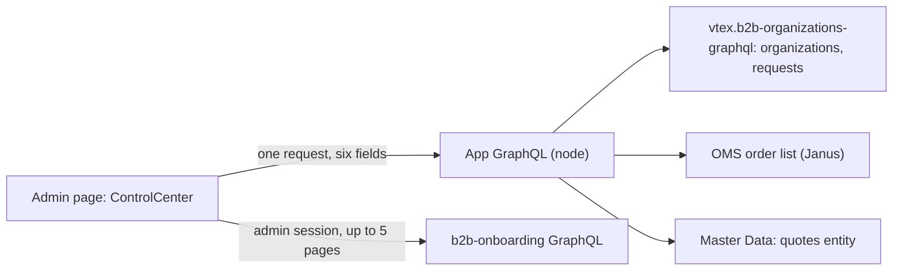

# B2B Control Center: technical reference

How the dashboard is built, where each panel's data comes from and why. For what users see, read [USER-GUIDE.md](USER-GUIDE.md).

| | |
| --- | --- |
| App | `logixalpartnerus.b2b-control-center` 0.2.2 |
| Builders | `admin` 0.x, `react` 3.x, `node` 7.x, `graphql` 2.x, `messages` 1.x, `docs` 0.x |
| Stored data | None. It only reads |
| Depends on | `vtex.b2b-organizations-graphql` 2.x, `logixalpartnerus.b2b-onboarding` 0.x (stable versions only), `vtex.styleguide` 9.x, `vtex.render-runtime` 8.x |

## Contents

1. [Architecture](#architecture)
2. [Admin page](#admin-page)
3. [GraphQL API](#graphql-api)
4. [Panels and their sources](#panels-and-their-sources)
5. [Rules](#rules)
6. [Security](#security)
7. [Policies and clients](#policies-and-clients)
8. [Code layout](#code-layout)
9. [Adding a panel](#adding-a-panel)
10. [Things to know](#things-to-know)

## Architecture



- The page asks the app's GraphQL for every panel in **one request**. GraphQL resolves the fields in parallel, and a failing field returns `null` with its own error, so the other panels still show (`errorPolicy: 'all'`).
- The **onboarding panel is read by the page itself**, from B2B Onboarding's GraphQL with the admin's session. VTEX IO only lets one app's server call another app's GraphQL when the target declares a policy, and B2B Onboarding declares none. The page builds that panel's counts in the browser (`utils/panels.ts`, `summarizeOnboarding`) with the same rules as the server.

## Admin page

| File | What |
| --- | --- |
| `admin/navigation.json` | Menu entry under **Apps** (`section: storeSetup`) pointing to `/admin/b2b-control-center` |
| `admin/routes.json` | `admin.app.b2b-control-center` → `ControlCenter` at `/admin/app/b2b-control-center` |

Only this 3.x navigation shape showed up in the Admin; a v4 `storeSettings/storeFront` entry built but never appeared, and `section: customers` was rejected.

The page uses VTEX Styleguide (`Layout`, `PageHeader`, `Dropdown`, `Button`, `PageBlock`, `Pagination`, `Tag`, `Alert`, `Spinner`). The tiles are a WAI-ARIA tab list (`role="tablist"`, arrow keys move between tabs). Messages are in `messages/` under `admin/b2b-control-center.*`.

## GraphQL API

`graphql/schema.graphql`. Every query has `@auth(scope: PRIVATE, productCode: "97", resourceCode: "buyer_organization_view")` and `@cacheControl(scope: PRIVATE)`. There are no mutations. Fields are nullable on purpose, so a failing source returns `null` for its panel only.

| Query | Arguments | Returns |
| --- | --- | --- |
| `controlCenterOrganizations` | | `[{ id, name, status }]` for the filter and for names in the panels |
| `controlCenterSettings` | | `{ staleAfterHours }` |
| `organizationRequestsPanel` | | `{ total, stale, items, truncated }` |
| `problemOrdersPanel` | `organizationId` | `{ total, inError, inRetry, stale, organizationsChecked, items, truncated }` |
| `quotesPanel` | `organizationId` | `{ total, waitingOnSeller, waitingOnBuyer, stale, items, truncated }` |
| `creditHoldsPanel` | `organizationId` | `{ available: false, total: 0, items: [], truncated: false }` for now |

`organizationId` is checked against `^[A-Za-z0-9-]{1,64}$` before it reaches any query, because it ends up in OMS and Master Data filters. Anything else is refused with "Invalid organization ID".

## Panels and their sources

### Applications in review (browser)

`graphql/onboarding.graphql` against `logixalpartnerus.b2b-onboarding`: `onboardingApplications(status: IN_REVIEW, page, pageSize: 50)`, up to 5 pages (250 applications), sequential because each page says whether another exists. Waiting time runs from `updatedAt`, or `submittedAt` when there's none.

### Organization requests

`vtex.b2b-organizations-graphql` `getOrganizationRequests(status: ["pending"])`, 100 per page, up to 5 pages. Rows link to `/admin/b2b-organizations/organizations#/requests`.

### Problem orders

The OMS order list (`GET /api/oms/pvt/orders`, through a `JanusClient`), filtered by `f_UtmCampaign` (B2B orders carry the organization ID in `marketingData.utmCampaign`) and the open statuses (`f_status`, comma-separated values are ORed):

`order-created`, `order-accepted`, `payment-pending`, `payment-approved`, `approve-payment`, `waiting-for-seller-confirmation`, `waiting-for-authorization`, `waiting-ffmt-authorization`, `authorize-fulfillment`, `window-to-cancel`, `ready-for-handling`, `start-handling`, `handling`, `request-cancel`, `cancellation-requested`.

The list doesn't say which organization an order belongs to, so:

1. Organizations are grouped 20 at a time and each group is probed once (page 1, all 20 IDs in `f_UtmCampaign`).
2. Only groups with open orders are read organization by organization, 100 orders per page, up to 3 pages each.
3. At most 6 calls run at once.

Each order's problem: `workflowInErrorState` → `WORKFLOW_ERROR`; `workflowInRetry` → `WORKFLOW_RETRY`; otherwise `lastChange` older than the threshold → `STALE`; otherwise it's fine and left out. Status words come from the status code ("ready-for-handling" → "Ready for handling"), not OMS's `statusDescription`, which follows the account's language (Portuguese here). Totals are cents.

### Quotes waiting

B2B Quotes' Master Data entity `quotes`, through `@vtex/api`'s `MasterData` client with the Admin user's token. B2B Quotes' own `getQuotes` takes its rights from the shopper's storefront session and returns nothing for Admin users (2.9.3 and 4.1.0, tested 2026-11-18).

Four searches in parallel: seller-side and buyer-side rows (99 each, the largest page used), and the stale counts of each (`size 0`, count only). Filters:

- Seller: `(status=pending OR status=revised)`
- Buyer: `status=ready AND expirationDate>{now}`
- Plus `organization={id}` with the filter, and `lastUpdate<{cutoff}` for the stale counts.

A buyer-side quote that expired between the search and now is dropped. Rows link to `/b2b-quotes/{id}` in the store.

### Credit holds

No source yet. The resolver checks the filter and returns the empty shape, so the page can show the panel.

## Rules

`node/domain/rules.ts`, shared by all panels:

- **Waiting too long:** a date older than `now − staleAfterHours`. Unreadable dates are never stale.
- **Threshold:** app setting `staleAfterHours`, an integer from 1 to 720; anything else falls back to 24.
- **Order:** oldest first; rows without a readable date go last. Problem orders: errors, then retries, then stale.
- **Limits:** each panel lists at most 500 rows (`PANEL_LIMIT`) and sets `truncated` when a source had more than it read.
- **Per request, once:** organizations and settings are read once per GraphQL request and shared by the panels (`perRequest`, a `WeakMap` keyed by the request context).

## Security

- **Every source runs as the Admin user who opened the page.** `adminHeaders` (`node/clients/adminToken.ts`) sends `adminUserAuthToken` as `VtexIdclientAutCookie`; without it, the call fails with "An admin session is required". The app never falls back to its own token, so each source applies that user's permissions on top of the product 97 check.
- **Errors never carry the token.** `sourceError` keeps the source name, HTTP status and the source's own message (at most 300 characters), never request headers.
- **Filters are checked** before reaching OMS or Master Data (see the ID pattern above).
- **Read only.** No mutations, no stored data.

## Policies and clients

| Policy | For |
| --- | --- |
| `vtex.b2b-organizations-graphql:resolve-graphql` | Organizations and requests |
| `outbound-access` `portal.vtexcommercestable.com.br/api/oms/pvt/orders` | The order list |
| `outbound-access` `api.vtex.com/api/dataentities/quotes/search` | Quotes |

| Client | Type | Source |
| --- | --- | --- |
| `B2BOrganizations` | `AppGraphQLClient` | `vtex.b2b-organizations-graphql@2.x` |
| `Oms` | `JanusClient` | `/api/oms/pvt/orders` |
| `QuotesMasterData` | `@vtex/api` `MasterData` | entity `quotes`, schema `v1.3` (B2B Quotes') |

All calls: 2 retries and a 3-second timeout, so a slow source fails its own panel instead of holding the page (the vtex/skills guidance is 1 to 3 seconds).

## Code layout

```
node/
  index.ts                  service, clients config, resolvers
  clients/                  B2BOrganizations, Oms, QuotesMasterData, adminToken, errors
  resolvers/panels.ts       one resolver per query
  resolvers/shared.ts       organizations and settings once per request, filter check
  domain/rules.ts           stale, ordering, problems, quote filters
  domain/concurrency.ts     perRequest and mapLimit
react/
  ControlCenter.tsx         page, filter, refresh, onboarding loading
  components/SummaryTiles.tsx
  components/Panels.tsx     the five panels
  components/common.tsx     frame, table, pager, waiting time, row links
  utils/panels.ts           onboarding summary, ages, paging, formatting
  utils/links.ts            where each row opens
graphql/schema.graphql, react/graphql/*.graphql
admin/                      navigation and route
```

## Adding a panel

Customer sync, contract errors and integration exceptions are the next panels Logixal's requirement names; each needs a source, usually an ERP or middleware. For one more panel:

1. A client for the source in `node/clients`, sending `adminHeaders` and wrapping failures with `sourceError`.
2. A query in `schema.graphql` with the same `@auth` and `@cacheControl`, returning `{ total, stale, items, truncated }`.
3. A resolver in `resolvers/panels.ts` using `settings(ctx)` for the threshold and `PANEL_LIMIT`.
4. The field in `react/graphql/panels.graphql`, a tile in `ControlCenter.tsx` and a panel in `components/Panels.tsx`.
5. An `outbound-access` policy if the source is an external host.

## Things to know

- `b2b-onboarding` must be **stable** (deployed) for this app to publish: an app can only depend on stable versions.
- If B2B Onboarding has no Master Data access, as happened in `b2btest` on 2026-11-25 after a faulty install, the Applications tile fails while the others work.
- Tests: `yarn test` runs 87 tests (resolvers, clients, rules and every screen); `yarn test:coverage` fails under 80% of lines (70% of branches). See [TESTING.md](TESTING.md).
