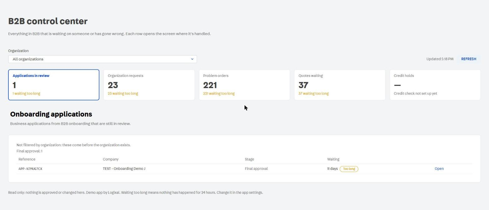
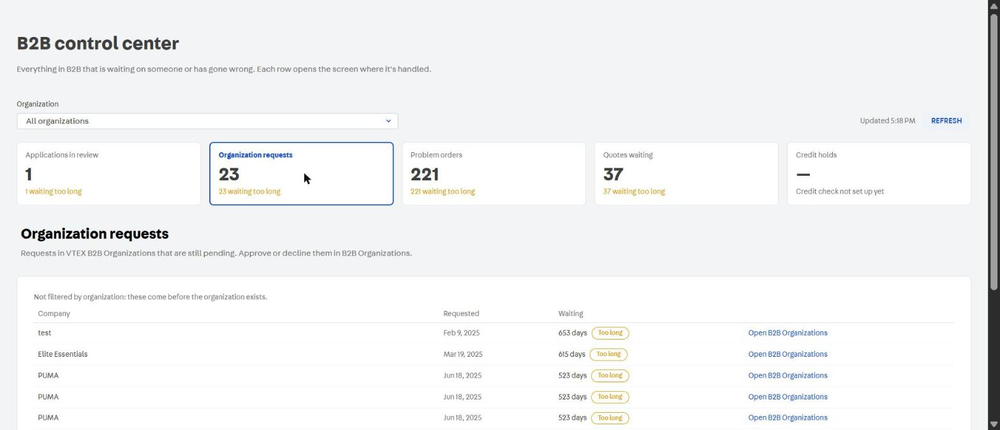
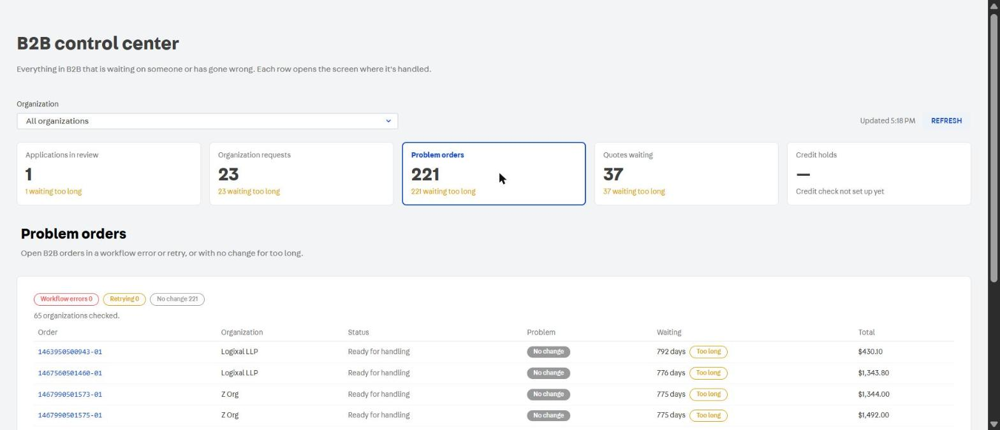
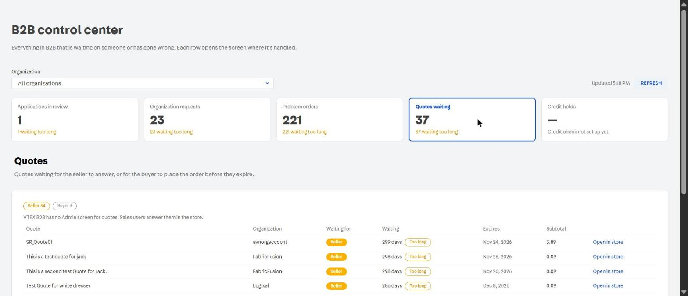
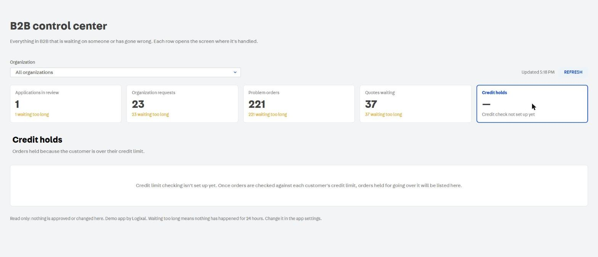
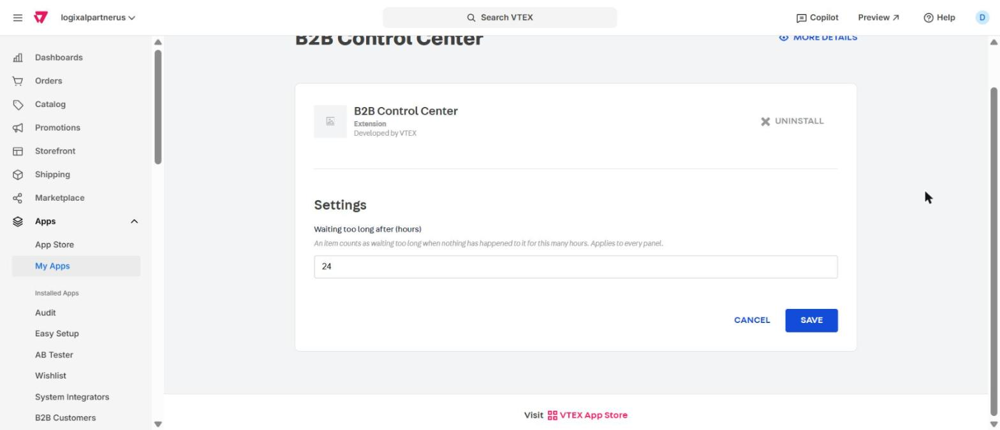

# B2B Control Center: user guide

Every part of the dashboard, what each panel counts, and what each message means. For how it's built, see [TECHNICAL.md](TECHNICAL.md); for test steps, [TESTING.md](TESTING.md).

Examples use the `b2btest` workspace.

## Contents

1. [Opening it](#opening-it)
2. [The page at a glance](#the-page-at-a-glance)
3. [Applications in review](#applications-in-review)
4. [Organization requests](#organization-requests)
5. [Problem orders](#problem-orders)
6. [Quotes waiting](#quotes-waiting)
7. [Credit holds](#credit-holds)
8. [The organization filter](#the-organization-filter)
9. [Settings](#settings)
10. [Messages](#messages)
11. [Common questions](#common-questions)

## Opening it

In the Admin: **Apps → Installed Apps → B2B control center** (`/admin/b2b-control-center`). The page can also be opened on its own at `/admin/app/b2b-control-center`.

The Admin user needs the License Manager right **Buyer Organization View** (product 97, Buyer Organizations), as for VTEX's B2B Organizations screens, for example through the `b2b-admin` role. Each source also applies the user's own permissions.

## The page at a glance

- **Organization** filter and **Refresh**, with the time the data was read.
- **Five tiles**, one per panel, with the number of items. Under each, in orange, how many are **waiting too long**: nothing has happened to them for longer than the setting (24 hours by default). A tile that failed says "Couldn't load".
- **The tiles are tabs.** Click one, or use the left and right arrow keys, to show its panel below.
- **Each row links to where it's handled.** Admin pages open in the whole window, so the Admin menu stays; store pages open in a new tab.
- **Read only.** Nothing is approved, retried or changed from this page, as the note at the bottom says.

Each panel shows 10 rows at a time, with a pager under the table (10, 25 or 50 rows). It lists at most the 500 oldest items and says so when there are more ("Listing the 500 oldest of …").

## Applications in review

Business applications from the B2B Onboarding app that are still in review.

| Column | Shows |
| --- | --- |
| Reference | The application's reference (`APP-…`) |
| Company | The legal company name |
| Stage | Where it is now, such as Document review |
| Waiting | Time since its last change, or since it was submitted; **Too long** past the threshold |
| Open | Its review page in B2B Onboarding |

Above the table, a count per stage, such as "Compliance check: 2". Oldest first. Not filtered by organization: applications come before an organization exists.

## Organization requests

Requests from VTEX's own "Organization Signup" form that nobody has approved or declined yet. Company, trade name, when it was requested, how long it has waited, and **Open requests**, which goes to **B2B Organizations → Organizations → Requests**, where they're approved. Oldest first, not filtered by organization.

## Problem orders

B2B orders that are still open and need attention:

| Chip | Counts orders |
| --- | --- |
| Workflow errors | In a workflow error in VTEX's order management |
| Retrying | That VTEX is retrying |
| No change | Open, without errors, but unchanged for longer than the threshold |

"Open" means not yet invoiced or canceled: from order created through handling, plus cancellation requested. Errors come first, then retries, then the rest; oldest first within each.

Columns: order number (opens the order in **Orders**), organization, status in words (such as "Payment pending"), problem, waiting time and total. "… organizations checked" says how many organizations' orders were read.

## Quotes waiting

Quotes from VTEX B2B Quotes that someone has to act on:

| Waiting on | Quote status | Meaning |
| --- | --- | --- |
| Seller | `pending`, `revised` | The sales team has to answer |
| Buyer | `ready`, not expired | The buyer can place the order before it expires |

Columns: quote name, organization, who it waits on, waiting time, expiry date and subtotal. **Open in store** opens the quote in a new tab: VTEX B2B has no Admin screen for quotes, so sales users answer them in the store.

## Credit holds

Orders held for going over a customer's credit limit. It's empty for now and says why: credit limit checking isn't set up yet. The tile says "Credit check not set up yet". Once a credit hold app exists, its holds appear here with no change to the page.

## The organization filter

Choosing an organization narrows **Problem orders**, **Quotes waiting** and **Credit holds** to that organization. **Applications in review** and **Organization requests** stay the same, and say so: they come before the organization exists. **All organizations** goes back to everything.

## Settings

**Apps → Installed Apps → B2B control center → Settings**:

| Setting | Default | Allowed | Effect |
| --- | --- | --- | --- |
| Waiting too long after (hours) | 24 | 1 to 720 | When an item counts as waiting too long, on every panel |

The note at the bottom of the dashboard repeats the value in use.

## Messages

| Message | Meaning | What to do |
| --- | --- | --- |
| … on a tile | The panel is loading | Wait |
| Couldn't load (tile), "Couldn't load this panel. …" | That source failed; the message says which and why | Click **Refresh**. The other panels are unaffected |
| Nothing waiting. | The panel has nothing to show | Nothing |
| Stopped reading early, so the counts may be low. | A source had more than the panel reads | Narrow with the organization filter |
| Listing the 500 oldest of … | More items than the panel lists | Handle the oldest first, or narrow the filter |
| Not filtered by organization … | The panel ignores the filter by design | Nothing |

## Common questions

**Why is a number different from VTEX's own screens?** The dashboard counts only what's waiting: pending requests, open orders with a problem, quotes someone has to act on. VTEX's screens show everything.

**Why can't I approve from here?** It's read only on purpose: it can be given to support staff, and every fix happens in the screen built for it, with its own checks.

**Who sees what?** Every source is read as the Admin user who opened the page, so the dashboard never shows more than that user could see in VTEX itself.

**What about customer sync, contract errors and integration exceptions?** They need an ERP or other integration as their source, which this demo doesn't have. Each would be one more panel.
